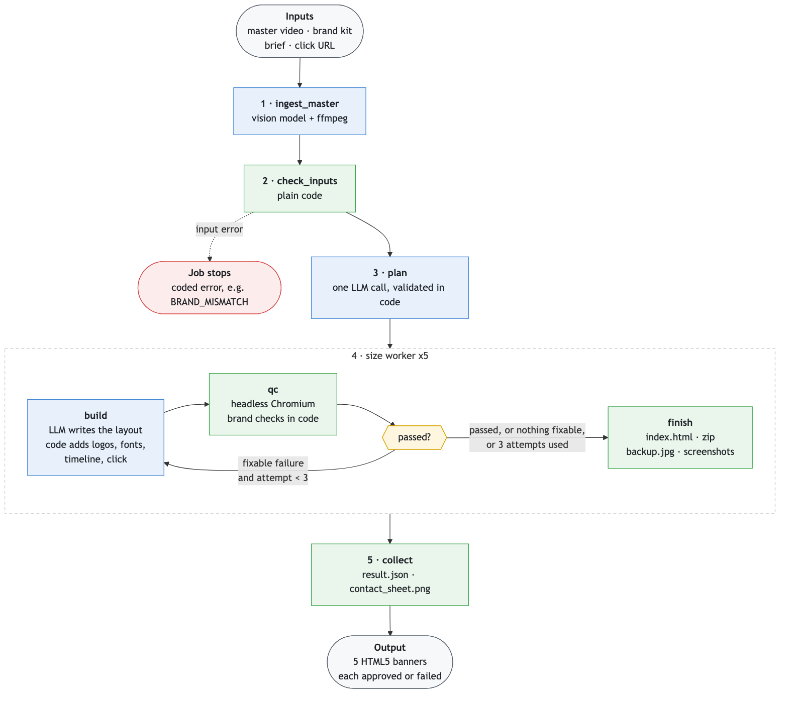

# Mini Creative Agent

Takes a storyboard video ad (Maxis "RM100 Million Device Sale"), a brand kit and a brief, and produces the same ad as five HTML5 banners: 300×250, 728×90, 320×50, 160×600 and 970×250. Each banner is checked in a headless browser against the brand kit, in code, before it counts as done. Python, LangGraph, FastAPI, Playwright, MCP.

Full architecture, QC catalogue, trace walkthrough and trade-offs: [docs/ARCHITECTURE.md](docs/ARCHITECTURE.md).

## Setup and run

Needs [uv](https://docs.astral.sh/uv/) and an Anthropic API key.

```bash
make setup      # installs dependencies and Chromium, creates .env; then set ANTHROPIC_API_KEY in .env
make agent      # terminal 1: agent server on http://127.0.0.1:8000
make demo       # terminal 2: runs the Maxis job, prints stages and per-size results
```

`make demo` prints each stage, then the result per size (`approved` or `failed`, with the number of attempts). Output lands in `data/jobs/<job_id>/`:

- `sizes/<WxH>/`: `index.html`, `<WxH>.zip`, `backup.jpg`, `final_frame_<n>.png` (screenshots) and `qc_attempt_<n>.json` (one QC report per attempt)
- `contact_sheet.png` (all five sizes side by side), `result.json`, `trace.jsonl`

Open any `index.html` in a browser to play the ad.

Also: `make demo-mismatch` (the Income storyboard must stop with `BRAND_MISMATCH`), `make test` (268 tests, no API key needed), `make compare` (single prompt vs agent benchmark).

## Add it to an MCP client

`make mcp` starts the MCP server over stdio. The client launches it, so you don't run it by hand. Start the agent (`make agent`) first; the MCP server only forwards requests to it.

Add this to the client's MCP config (for example `.bob/mcp.json` in Bob, or `claude_desktop_config.json` in Claude Desktop):

```json
{
  "mcpServers": {
    "creative-agent": {
      "command": "make",
      "args": ["--no-print-directory", "-C", "/absolute/path/to/repo", "mcp"],
      "env": { "PATH": "/path/to/uv/folder:/usr/bin:/bin" }
    }
  }
}
```

- `-C` makes `make` run in the repo, so it finds the `Makefile` and `.env`. Clients that support a variable such as `${workspaceFolder}` can use it here.
- `--no-print-directory` stops `make` writing to stdout, which carries the MCP protocol.
- `PATH` must include the folder that holds `uv` (run `which uv`), because a client's own `PATH` is often minimal.

Reload the client's MCP servers. `creative-agent` should list three tools: `create_job`, `get_job_status` and `get_result`. Ask the client to call `create_job` with `inputs/maxis-merdeka`, then `get_result` with `wait_s: 60`.

To try it without a client: `npx @modelcontextprotocol/inspector make --no-print-directory -C . mcp`.

## Design



Blue nodes call a model; green nodes are plain code.

| Node | What it does |
|---|---|
| **ingest_master** | Samples the video at 4 fps and keeps one frame from each stable scene. A vision model reads each frame: copy, text boxes, highlighted words, product areas, which brand it is. Product images are cropped out. The result is cached, so the same master is read once. |
| **check_inputs** | Stops bad jobs before any planning cost. Checks the master's brand against the brand kit, picks up the CTA, snaps sampled text colours to the palette, confirms legal text, tests that the logo fits every size and that the click URL answers. Problems that can be worked around become logged issue codes ([docs/INPUT_PROBLEMS.md](docs/INPUT_PROBLEMS.md)); the rest stop the job. |
| **plan** | One model call for all five sizes: which scenes become frames, which copy each frame keeps, how long each lasts, and which frame is the backup image. Code validates the plan (offer scene present, CTA on the last message frame, legal text kept, at most 30 s). Copy is never reworded. |
| **size worker** | The same loop run once per size, in parallel, so a failure in one size doesn't hold up the others. |
| **build** | The model writes only the layout (HTML and CSS). Code then adds everything that must be exact: logos, fonts, frame timeline, click handler, and image quality that fits 150 KB. |
| **qc** | Renders the final `index.html` in headless Chromium, screenshots every frame and runs 21 per-frame checks read from `brand_kit.json` (overflow, canvas bounds, logo size and spacing, colours, fonts, copy, legal text, CTA and more). It also checks file size under 150 KB, that clicking opens the click URL, and that the landing page loads. |
| **passed?** | Pass goes to `finish`. A fixable failure goes back to `build` with the exact failure messages, up to 3 attempts. If only code-owned checks failed (`logo_spec`, `timeline`, `landing_url`), the size stops at once as failed. |
| **finish** | Writes `index.html`, the zip, `backup.jpg` and per-frame screenshots, and marks the size approved or failed. |
| **collect** | Joins the five sizes into `result.json` and `contact_sheet.png`, with issues, cost and the job status (`completed`, `completed_with_failures` or `failed`). |

`trace.jsonl` records every node, model call (prompt and response saved under `trace/`, tokens, cost), QC check and input fix. Assumptions: [docs/ASSUMPTIONS.md](docs/ASSUMPTIONS.md). Departures from the plan: [docs/DEVIATIONS.md](docs/DEVIATIONS.md).

## Benchmark: single prompt vs agent system

5 runs per mode, 25 ads each, same inputs, same QC, model `anthropic:claude-haiku-5-5` (`make compare`; raw data in `bench/results.csv`).

| Mode | First-try pass rate | Final pass rate | Cost per approved ad |
|---|---|---|---|
| single_prompt | 8% (2/25) | 8% (2/25) | $0.0100 |
| agent | 40% (10/25) | 96% (24/25) | $0.0033 |

The single prompt is cheaper per run but almost never passes, so each approved ad costs about 3× more. The one-off ingest step was served from cache, so its cost is not included.

## What didn't work

- The Maxis font and logo files were not provided: logos are cropped from the video and PDF, and Figtree stands in for the font.
- Product images are rectangular crops, so they carry a little of the source background.
- Colours sampled from the video are off-palette; they are snapped to the kit and never used as brand colours.
- First-try pass rate is only 40%. Across the five agent runs, 15 of 18 failed first-attempt checks were text overflowing its box or leaving the canvas. The QC-and-retry loop is what gets the final rate to 96%; one size (970×250, `text_overflow`) still failed.

## With 2 more weeks

- Official logo SVGs and font files once provided (a kit change only).
- Background removal for clean product cutouts.
- A vision-model review of screenshots as an advisory score.
- A rendered-font check through Chrome DevTools, and perceptual colour matching.
- A durable job queue; Langfuse tracing and a trace viewer.
- Alignment with Adzymic's AdCP creative protocol; A2A if the agent must ask the caller questions mid-job.
- Make the system fully brand-agnostic; a few Maxis-specific assumptions remain today.

