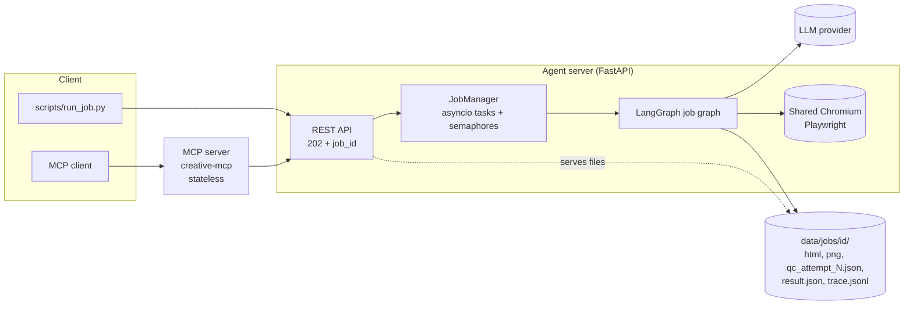
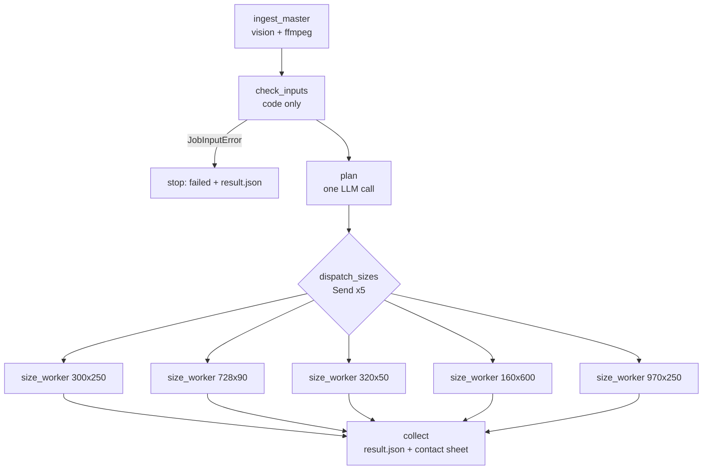
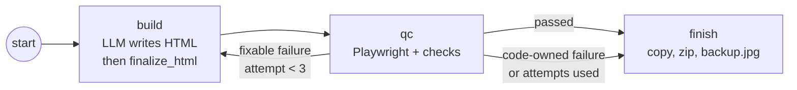

# Architecture

Detailed walkthrough of the Mini Creative Agent, for the interview. The one-page summary is in the [README](../README.md).

Contents: [1 Problem](#1-the-problem-in-one-minute) · [2 Demo script](#2-demo-script) · [3 System overview](#3-system-overview) · [4 Graph and nodes](#4-the-graph-node-by-node) · [5 Contract between model and code](#5-the-contract-between-the-model-and-code) · [6 QC](#6-qc) · [7 Retry logic](#7-retry-logic) · [8 Brand kit](#8-brand-kit-as-data) · [9 Input problems](#9-input-problems) · [10 Async, API and MCP](#10-async-jobs-api-and-mcp) · [11 Trace and cost](#11-trace-and-cost) · [12 Benchmark](#12-benchmark) · [13 Testing](#13-testing) · [14 Decisions](#14-key-design-decisions-and-trade-offs) · [15 Limits](#15-known-limits) · [16 Q&A](#16-likely-questions) · [17 Repo map](#17-repo-map)

## 1. The problem in one minute

| | |
|---|---|
| **Input** | One storyboard video (Maxis, 9:16, 20 s, six scenes), a brand kit (a 45-page PDF, converted to `brand_kit.json`), a brief, a click URL |
| **Output** | The same ad as five HTML5 banners: 300×250, 728×90, 320×50, 160×600, 970×250, each ≤ 150 KB, with a zip, a backup JPG and per-frame screenshots |
| **Hard part** | Every banner must obey the brand kit, and "obey" has to be proven by code, not by a prompt |
| **Approach** | The model decides *what* each banner shows and writes the layout. Code owns everything that must be exactly right (logos, fonts, timeline, click handler, size budget) and checks the rest in a real browser |

## 3. System overview



- The agent server is the only component with state. The MCP server and the CLI both go through the same `AgentClient` (`client.py`), which uploads file contents, so the agent works the same locally or remotely.
- One Chromium instance is shared by all jobs. A semaphore caps open pages (`max_open_pages`, default 4); another caps concurrent jobs (`max_concurrent_jobs`, default 2).

## 4. The graph, node by node



Each `size_worker` runs a subgraph:



| Node | Kind | Input | Output | Why it is separate |
|---|---|---|---|---|
| `ingest_master` | vision LLM + ffmpeg + OCR | master video/image, reference images | `master_spec.json`: scenes, text elements with boxes, product crops, detected brand, layout notes | Expensive and brand-independent, so the result is cached. Key = file contents + prompt version + vision model |
| `check_inputs` | plain code | master spec, brand kit, `job.json` | cleaned content list, `brand`, issues; or a `JobInputError` | Cheap, deterministic, and it stops bad jobs *before* any planning cost |
| `plan` | one LLM call, structured output | brief, scenes, layout notes, per-size guidance | a `Plan`: per size, which scenes become frames, which elements each keeps, durations, backup frame | One call sees all sizes, so they stay consistent. It decides *content*, never wording |
| `build` | LLM call per size, then `finalize_html` | the size plan, content, brand rules, (on retry) its previous HTML and the QC failures | `attempt_N.html` | Different layout problem per size, so five parallel, independently retried branches |
| `qc` | Playwright + code | the finalized HTML | `QCReport` with per-check results and screenshots | Separate from the builder so it measures the shipped bytes and cannot be talked out of a failure |
| `finish` | code | final HTML and screenshots | `index.html`, `<WxH>.zip`, `backup.jpg`, `final_frame_*.png` | Packaging is mechanical |
| `collect` | code | all size results | `result.json`, `contact_sheet.png` | Joins the five branches |

Details worth knowing:

- **Ingest.** `video.sample_gray` samples at 4 fps; `stable_segments` finds stretches where consecutive frames barely differ (crossfades break a stretch), and one frame is taken from the middle of each. A vision model then extracts text, bounding boxes, highlight words, product regions and the detected brand. The result is checked: scene ids must match, boxes must be inside the image, text must be present. Product images are cropped from the frame, and OCR (optional Tesseract) cross-checks the extracted copy (`COPY_EXTRACTION_MISMATCH`) and flags crops that contain text (`CROP_CONTAINS_TEXT`).
- **`check_inputs`** runs nine checks in order: brand match, `copy.json` override, text colour snapping, CTA, legal text, assets (font, logo provenance, image resolution), logo feasibility per size, master deviations, click URL reachability.
- **Plan validation** (`validate_plan`) is code: exactly the requested sizes, the offer scene in every size, the end frame last, the CTA exactly once on the last frame before the end frame, frames that show products keep the legal text, every frame at least 1000 ms, total duration within the kit's limit, backup frame is not the end frame. On failure the planner is asked once more with the problem list (`ask_structured`, `repairs=1`), then the job fails with `LLM_OUTPUT_INVALID`.
- **Parallelism.** `dispatch_sizes` returns five `Send` objects. The size subgraph is wrapped by `size_worker_node`, which returns only `results`, because five parallel branches writing the same state keys (`brand`) would be a LangGraph error.
- **Runtime context.** The browser, tracer, LLM clients and semaphores live in `JobContext`, passed as LangGraph runtime context and never stored in state.

## 5. The contract between the model and code

The builder writes only a `<style>` and a `<div id="ad">`. Code does the rest.

| Written by the model | Written by code (`finalize_html`) |
|---|---|
| One `div.frame[data-scene]` per planned frame, as direct children, in order | `<meta name="ad.size">`, global `clickTag`, click handler |
| Layout and CSS (gradient backgrounds only) | `#ad` size and `overflow` (forced with `!important`) |
| `data-role` and `data-el` on each text element; `<strong data-role="highlight">` | Font `@font-face`, subset to the characters used and embedded as WOFF2 |
| Product images as `` | Image encoding (WebP) sized from measured placement, inlined |
| | Corner logo and end-frame logo, colour variant chosen from the measured background luminance |
| | Frame timeline (CSS crossfades, plays once, holds the last frame), `window.__ad.show(i)` |

`parse_model_html` enforces the contract before anything else and reports `contract:` errors: missing `#ad`, wrong frames or order, images that are not approved `asset://` ids, CSS `url(...)` images, disallowed tags, inline handlers. These come back to the builder like any other fixable QC failure.

**Why this split.** Anything a brand check depends on exactly (logo size and spacing, font files, animation count and duration, click-through) is produced by code, so those can't be wrong because of a model slip. The model keeps the only part that needs judgement: composition.

**File size budget.** `finalize_html` works in two passes. Pass 1 renders with images as local files to measure where they land. Pass 2 computes what is left of the 150 KB budget (with a 2% margin) after HTML, CSS, fonts and logos, shares it between the images by area, and encodes each as WebP at the highest pixel density (2×, then 1.5×, then 1×) that fits, using the highest quality (40 to 85) at that density (`best_under`). If nothing fits even at 1× and quality 40, `budget_floor_hit` is set and the `file_size` check is marked not fixable, since asking the model again would not help.

## 6. QC

`qc_node` runs `run_qc` on the **final** `index.html`. It opens it in headless Chromium at device scale 2, blocks any request that is not `file:` or `data:`, and records console errors. For each planned frame it calls `window.__ad.show(i)`, takes a screenshot, runs `measure.js` to collect every element's box, computed style and role, and then runs every per-frame check.

### 6.1 Per-frame checks (21, `qc/checks.py`)

| Group | Checks |
|---|---|
| Layout | `canvas_bounds`, `text_overflow`, `text_overlap`, `text_occluded` (text hidden behind an image or box), `empty_shape` (stray empty boxes) |
| Images | `image_resolution`, `assets_whitelist` |
| Logo | `logo_spec` (size and spacing from the kit), `logo_variant`, `logo_no_container`, `adinfo_zone` (top-right reserved area) |
| Colour and type | `brand_colors`, `brand_fonts`, `font_weight_by_role`, `font_size_count`, `text_color_count`, `headline_lines`, `min_font_size` |
| Content | `copy_fidelity` (text equals the approved copy), `legal_present`, `cta_visible` |

### 6.2 Per-ad checks (`graph/nodes/qc.py`, `qc/browser.py`)

| Check | What it verifies | Fixable by the builder? |
|---|---|---|
| `contract` | model HTML follows the contract (see section 5) | yes |
| `file_size` | `index.html` ≤ 150 KB (measured on the uncompressed file, which is stricter than the zip) | yes, unless the budget floor was hit |
| `click_opens` | a real click calls `window.open` with exactly the click URL | yes |
| `landing_url` | the click URL answers 2xx/3xx (401/403 is a warning, since some sites block bots) | no |
| `timeline` | total duration ≤ 30 s and every animation plays once | no |
| `console_errors` | no console or page errors | yes |
| `external_requests` | no network request leaves the file | yes |
| `legal_once` | legal text appears in at least one frame | yes |

Results from all frames are merged into one result per check, with per-frame messages like `frame 5: cta (s5.headline) overflows its box by 40px`. Those exact messages are what the builder sees on a retry.

### 6.3 Why QC lives in the browser

Overflow, overlap, occlusion, line counts and computed colours, fonts and sizes can only be read from what the browser actually lays out. Reading the HTML would not catch a headline wrapping to a third line or text sitting under an image. Colours in `brand_colors` are compared against the palette with a tolerance (`color_tolerance` in the kit).

## 7. Retry logic

There are three separate retry mechanisms, deliberately kept apart:

| Level | Trigger | Policy | Where |
|---|---|---|---|
| Provider errors | rate limit, timeout, connection error, 5xx/overloaded | up to 3 attempts, exponential backoff (2 s, factor 2) | LangGraph `RetryPolicy` (`is_transient`) on the LLM nodes |
| Invalid structured output | schema error or domain validation (plan, extraction) | one repair attempt with the problems listed, then fail | `ask_structured` |
| QC failure | any failed check that is `fixable` | back to `build` with its own HTML and the exact failure lines; max `MAX_ATTEMPTS` (3) | `route_after_qc` |

`route_after_qc`: pass → `finish`; failed but nothing fixable (`logo_spec`, `timeline`, `landing_url`, budget floor) → `finish` immediately as `failed`; fixable and `attempt < 3` → `build`. A size that runs out of attempts is reported `failed` with its `failed_checks`, and the job becomes `completed_with_failures`. A size is never approved without passing.

Job status: `completed` (all approved), `completed_with_failures` (some approved), `failed` (none approved, or an input/model error stopped the job).

## 8. Brand kit as data

`config/brands/maxis/brand_kit.json` is the single source of brand truth. It is loaded into a typed model (`brand.py`), and both the prompts and the QC checks read it, so a rule exists in one place.

It holds: colour palette with hex and roles, allowed text colours and tolerance, font family, substitute files and weight per role, typography limits (max font sizes and text colours per frame, headline lines, minimum sizes), logo variants with corner and end-frame placement and per-size overrides, the reserved ad-info zone, CTA shape, the 60/40 visual/copy grid, motion limits (≤ 30 s, plays once), the 150 KB limit, and the provenance of assets (`logos: crop`, `fonts: substitute`).

A new brand is a new folder under `config/brands/<id>/` with a kit, logos and fonts. The QC checks read only the kit, and no file under `src/` names Maxis.

The kit was converted from the PDF offline and reviewed. `brand_kit_notes.md` records the source page of each rule, the contradictions in the PDF and how each was resolved, and the values that are extrapolated rather than stated in the PDF.

## 9. Input problems

The assignment says the inputs contain realistic problems. These are the ones found and how each is handled. Every handled problem becomes an `Issue` in `result.json` and an `input_fix` event in the trace.

| Problem | Handling | Code |
|---|---|---|
| Wrong brand (Income storyboard) | Stop before planning | `BRAND_MISMATCH` |
| Brand kit is a PDF with rules only in images | Converted offline, reviewed, page per rule | `brand_kit_notes.md` |
| No logo files | Cropped from the video end frame and PDF, recoloured to exact brand hex | `LOGO_FROM_CROP` |
| Proprietary Maxis font | Open-licence Figtree, same weights per role | `BRAND_FONT_SUBSTITUTED` |
| No CTA in the master | The closing line becomes the CTA; copy unchanged | `CTA_ADDED` (stops with `NO_CTA` or `CTA_NOT_FOUND` if impossible) |
| Stacked logo cannot fit 320×50 | Horizontal logo, which the PDF allows | `LOGO_VARIANT_SWITCHED` |
| 160×600 and 320×50 missing from the PDF's size list | Same corner rule applied | `LOGO_SPEC_EXTRAPOLATED` |
| Master breaks the PDF's rules (end-frame logo about 29% of width vs 20%) | Banners follow the kit | `MASTER_RULE_DEVIATION` |
| Colours sampled from video are off-palette | Snapped to the nearest palette colour | `COLOR_SNAPPED` |
| Kit contradicts itself (CTA colour, 3 vs 4 font sizes) | Resolved and recorded | `ASSUMPTIONS.md` A2, A11 |
| Text baked into video frames | Products cropped from the text-free band; background rebuilt in CSS | design |
| Static reference is a different offer | Used for layout only, never its copy | design |
| 9:16 source, horizontal targets | New composition from the reference layout and the 60/40 grid | design |
| No brief, no landing URL | Brief written from the ads; public Maxis URL | A5, A6 |

Input errors that stop a job (never retried): `BRAND_MISMATCH`, `NO_CTA`, `CTA_NOT_FOUND`, `COPY_OVERRIDE_UNKNOWN_ID`, `LOGO_SPEC_IMPOSSIBLE`, `CLICK_URL_UNREACHABLE`, `INGEST_FAILED`. A model answer that still fails validation after the repair attempt stops the job with `LLM_OUTPUT_INVALID`.

Full table: [INPUT_PROBLEMS.md](INPUT_PROBLEMS.md). All assumptions: [ASSUMPTIONS.md](ASSUMPTIONS.md). Departures from the plan: [DEVIATIONS.md](DEVIATIONS.md).

## 10. Async jobs, API and MCP

### 10.1 REST API (`agent_service/app.py`)

| Route | Purpose |
|---|---|
| `POST /jobs` | multipart upload (master, references, optional `copy`/`boxes`); returns `202` and a `job_id` at once |
| `GET /jobs/{id}` | status, current stage, per-size status |
| `GET /jobs/{id}/result` | `result.json`; `409` while the job is still running |
| `GET /jobs/{id}/files/{path}` | any output file |
| `GET /brands`, `GET /healthz` | available brands, liveness |

An optional bearer token (`AGENT_TOKEN`) protects the job routes.

### 10.2 Job lifecycle

`JobManager.submit` saves the upload (50 MB limit, master must be readable as video or image), persists `job.json`, and starts the run as an `asyncio` task. `_run` waits on the job semaphore, builds the `JobContext`, invokes the graph, and maps exceptions: input and model-output errors become coded failures; anything else becomes `CRASH` with the traceback in the trace. A failed job still gets a `result.json` with the issues logged so far.

Status is written atomically (temp file and `os.replace`) after every change. On start-up, `recover()` loads existing jobs and marks any that never finished as `failed` with `INTERRUPTED`.

### 10.3 MCP server (`mcp_server/server.py`)

A thin, stateless wrapper over `AgentClient`:

| Tool | Behaviour |
|---|---|
| `create_job(input_dir)` | uploads the folder, returns `job_id` at once with a hint on how often to poll |
| `get_job_status(job_id)` | stage and per-size status |
| `get_result(job_id, wait_s, include_screenshots)` | summary with per-size status, attempts, failed checks, KB, links to files, issues, cost; `wait_s` (max 60) blocks until done; can return the backup images |
| resource `ads://jobs/{id}/{size}/html` | final HTML for one size |

Because the MCP server holds no state, a job keeps running if the MCP client disconnects. Runs on stdio by default, or `--http` on port 8001. The server never writes to stdout except protocol messages.

## 11. Trace and cost

Each job writes `trace.jsonl`, one JSON object per line:

| Event | Contains |
|---|---|
| `node_start`, `node_end`, `node_error` | node, size, attempt, duration |
| `llm_call` | node, model, size, attempt, tokens in and out, cost, latency, `prompt_file`, `response_file` |
| `llm_error` | the exception |
| `qc_check` | size, attempt, check name, passed, fixable, message, frame |
| `input_fix` | issue code, severity, message, fix applied |
| `ingest_cache_hit`, `error` | cache key; failure code, message, traceback |

Prompts and responses are saved in `trace/llm_NNNN_prompt.txt` and `..._response.txt` (images are replaced with `[image]`). `TraceCallback` records `llm_call` events from LangChain callbacks, so every model call is traced without the nodes doing anything. Writes go through a lock because five branches append at once.

`Tracer.usage()` sums tokens and cost per node into `result.json`. Prices come from `config/pricing.yaml`; a model with no price gives `cost_usd: null` instead of a wrong number.

To walk a trace in the interview: ingest (a cache hit when the same master, references and model were used before) → `input_fix` events → one `plan` LLM call → five interleaved `build`/`qc` branches → a failed `qc_check` → the next `build` for that size with the failure lines in its prompt → passing `qc_check`s → `finish` → `collect`.

## 12. Benchmark

`make compare` runs the same job 5 times in each mode and writes `bench/results.csv`.

- **single_prompt**: one LLM call returns all five ads at once. It goes through the same `check_inputs`, the same `finalize_html` and the same QC, but with **no plan and no retry**.
- **agent**: the full graph.

| Mode | Ads | First-try pass | Final pass | Total cost | Cost per approved ad |
|---|---|---|---|---|---|
| single_prompt | 25 | 2 (8%) | 2 (8%) | $0.0200 | $0.0100 |
| agent | 25 | 10 (40%) | 24 (96%) | $0.0790 | $0.0033 |

Reading it: the single prompt costs about a quarter as much per run but almost never produces an approved ad, so the cost per approved ad is about three times higher. For the agent, 40% pass on the first attempt and 96% pass after retries.

Caveats: five runs per mode is a small sample; every run used `anthropic:claude-haiku-5-5`; cost excludes the ingest step because it was served from the ingest cache (`ingest_cost` is 0.0 in `bench/results.csv`). Both modes share the same ingest, `check_inputs`, `finalize_html` and QC, so the comparison isolates planning, per-size building and retries.

## 13. Testing

`make test` runs 268 tests with no API key, in about a minute.

| Area | How it is tested |
|---|---|
| QC checks | `tests/qc_mutations.py` defines 18 mutations of a known-good ad (`tests/fixtures/qc/make_good_ad.py`), each breaking one rule. The browser test asserts the set of failed checks is exactly the expected check plus any declared knock-on checks, and that the good ad passes every check |
| Graph | `tests/test_graph.py` and `tests/fakes.py` run the whole graph with a fake LLM, including retry paths |
| Finalize, timeline, colours, brand, plan validation, ingest, trace, API, MCP | one test file each |
| Real model | `make e2e` (marked `e2e`, needs a key) runs both jobs end to end |

The mutation tests are the answer to "how do you know QC works?": 18 checks are each shown to fire on a specific break, and the good ad shows none fire falsely. The other checks are covered by the unit tests for `checks.py` and the graph tests.

## 14. Key design decisions and trade-offs

| Decision | Why | Cost |
|---|---|---|
| Brand rules in code, read from the kit | Prompts drift; code can be tested; one source of truth | Needs a browser and a measurement script |
| Model writes layout only; code writes logos, fonts, timeline, click | Removes whole classes of failures and makes those checks deterministic | Model has less freedom; a small HTML contract to maintain |
| One graph node per concern, five parallel size branches | Isolates failure and retry; sizes run concurrently | More moving parts than one prompt |
| QC on the shipped bytes | What is checked is what is delivered | Slower than static checks |
| Fixable vs not-fixable failures | Retrying a failure the builder cannot influence wastes money | Needs each check classified |
| `check_inputs` is code and runs before planning | Bad inputs cost nothing | Rules must be written by hand |
| Ingest cached by content hash | The most expensive vision step runs once per master | Cache must be invalidated with the prompt version |
| Async job API; MCP server stateless | Jobs outlive clients; MCP is replaceable | A restart interrupts running jobs |
| Logos and font substitutes declared in the kit, surfaced as issues | Honest about missing assets instead of hiding it | Output is not final until official files arrive |
| Copy is never rewritten | Brand copy is approved; `copy_fidelity` enforces it | Small sizes drop frames rather than shorten text |

## 15. Known limits

- No official Maxis logo or font files. Logos are crops; Figtree stands in for the font.
- Product images are rectangular crops with a little source background.
- First-try pass rate is 40%, mostly text overflow and canvas bounds. One 970×250 size failed (`text_overflow`) after retries in the benchmark runs.
- Part of the brand kit was not re-checked against the PDF (pages 13, 19 and 38–43; see `brand_kit_notes.md`).
- QC checks which font family is declared, not the rendered font (a DevTools check is a follow-up).
- Job state is in memory plus files; a restart marks running jobs `INTERRUPTED`. No durable queue.
- Benchmark is small (5 runs per mode) and ingest cost is not included.
- No vision-model review of screenshots; QC is geometric and rule-based, so it cannot judge taste.

## 16. Likely questions

**Why multiple agents rather than one?** Each stage has a different input, failure mode and cost. Ingest is expensive and cacheable, `check_inputs` is free, planning is one cross-size decision, building is per size and parallel, QC must be independent of the builder. Splitting lets each be tested and retried alone, and lets a failure in one size not disturb the others.

**Where are brand rules enforced?** In `qc/checks.py` and `qc/browser.py`, reading `brand_kit.json`, against the rendered page. The prompt tells the model the rules, but the check is what counts.

**What stops the model from changing the copy?** The plan can only choose which elements to keep (`validate_plan` rejects unknown ids). `copy_fidelity` compares rendered text to the approved text per frame.

**What if QC is wrong?** The mutation tests show 18 checks firing on their specific break while the good ad passes. The trace and `qc_attempt_N.json` show the exact message for any failure.

**What happens when a size cannot pass?** It stops after three attempts, is reported `failed` with its `failed_checks`, other sizes are unaffected, and the job is `completed_with_failures`.

**How do you handle provider outages?** Transient errors are retried with backoff at node level. Persistent failures end the job with a coded error and a `result.json`. A restart marks interrupted jobs.

**How would you add another brand?** A new folder under `config/brands/` with kit, logos and fonts. Checks are generic. The ingest step detects the brand and `check_inputs` compares it with the kit.

**How would you add a size?** Add it to `Size` and `ALL_SIZES` in `models.py`; optionally add a section for it in `prompts/layout_tips.md`; add a logo override in the kit if the standard corner logo does not fit.

**How does it scale?** Sizes run in parallel inside a job; jobs are limited by `max_concurrent_jobs`; page rendering by `max_open_pages`. To go further: a durable queue and several agent workers, since the MCP and CLI clients are already stateless.

**Where does the cost go?** With `claude-haiku-5-5`, an agent job cost $0.012 to $0.018 across the five benchmark runs (`usage.by_node` in `result.json`). `build` is $0.011 to $0.016 of that and `plan` is $0.001 to $0.003. Ingest is cached.

**Why does the first try fail so often?** Most first-attempt failures are `text_overflow` and `canvas_bounds`, with messages like "overflows its box by 2px". The retry sends the builder that exact message. Ideas to raise the first-try rate: stricter size guidance in the builder prompt, or per-size font scales.

**What would you change first with more time?** Official assets; a vision review of screenshots as an advisory score; a rendered-font check; a durable queue; background removal for product cutouts; AdCP alignment.

## 17. Repo map

```
src/creative_agent/
  agent_service/   app.py (FastAPI routes), jobs.py (JobManager, lifecycle, recovery)
  mcp_server/      server.py (3 tools + html resource)
  graph/           graph.py (job, size and baseline graphs), state.py, nodes/ (one file per node)
  ingest/          video.py (ffmpeg), vision.py (LLM extraction), crops.py, ocr.py, cache.py
  qc/              browser.py (Playwright run, per-ad checks), checks.py (21 per-frame checks),
                   measure.js (DOM measurements), context.py
  render/          finalize.py (contract, fonts, logos, image budget), timeline.py (CSS animation)
  prompts/         planner, builder, vision, baseline prompts and per-size layout tips (markdown)
  brand.py         typed brand kit; models.py  pydantic models; llm.py  model calls and repair
  trace.py         tracer, callback, cost; client.py  shared HTTP client; colors.py  colour maths
Makefile           setup, agent, mcp, demo, demo-mismatch, test, e2e, compare
config/            brands/maxis (kit, logos, fonts, notes, source PDF), pricing.yaml
inputs/            maxis-merdeka (real job), income-storyboard (negative test)
scripts/           run_job.py, compare.py, extract_brand_kit.py, prepare_logos.py
tests/             268 tests, fixtures, mutation definitions, fake LLM
docs/              ARCHITECTURE, INPUT_PROBLEMS, ASSUMPTIONS, DEVIATIONS
data/              job outputs and the ingest cache (gitignored)
bench/             results.csv from make compare (gitignored)
```
